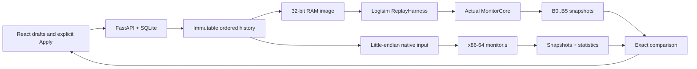
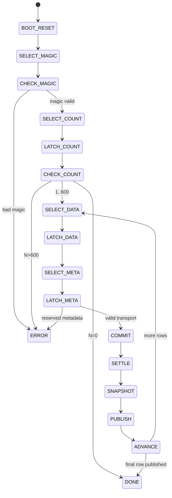

# Volcano monitoring system: implementation report

## Scope and targets

This is a synthetic educational monitoring laboratory combining digital logic, computer organization and assembly. It accepts normalized integer indices for ground vibration V, temperature anomaly T, gas G and activity/deformation A. The website controls an actual Logisim-evolution circuit through a replay harness and runs a separate native x86-64 GNU AT&T analyser over the identical ordered history. It demonstrates warnings, emergency signals, ten-sample counters, statistics and reproducible evidence. It does not predict eruptions, use an AI model or claim scientific sensor calibration.

The maximum session is600 readings. One accepted reading represents one simulated second. Wall-clock animation and evaluation time are independent of that sample clock. Fault rows consume one sample/window position but are excluded entirely from valid statistics and abnormal totals.

## Architecture



Java/Logisim computes hardware outputs. Assembly independently classifies and counts, and computes all required sums/minima/maxima/averages. Python validates protocols, persists history, coordinates bounded processes and compares outputs. React formats returned values and draws bounded illustrations. Only tests use the independent Python reference model. The SVG circuit view is a labelled architectural visualization, with the native .circ available separately.

## Boolean logic

Let x_i be the eight-bit unsigned input, t=(70,60,65,70), c_i its connectivity bit. Comparators use strict greater-than, so equality is normal.

```
r_i = [x_i > t_i]                     raw comparator
u_i = [x_i > 100]                     range fault
valid = (AND_i c_i) AND NOT(OR_i u_i)
fault = NOT valid
f_i = valid AND r_i                   effective flag
K = SUM_i f_i                        0..4
NORMAL = valid AND [K=0]
WATCH  = valid AND [K=1]
DANGER = valid AND [K>=2]
emergency = DANGER
warning_code = FAULT?3 : DANGER?2 : WATCH?1 : 0
```

Fault overrides classification, with K/effective flags/alarm zero; raw/range diagnostic bits are preserved. Per-sensor SensorCheck, Validity and WarningLogic are actual reusable native subcircuits. Constants and physical interfaces are checked against circuit/core-map.json.

## Sequential next-state equations

Seven counters C=(cV,cT,cG,cA,cReadings,cAbnormalSamples,cFaults) have widths(4,4,4,4,6,4,4). Per accepted sample:

```
d = (fV,fT,fG,fA,K,[K>0],fault)
reset: C'=0, L'=0, p'=0, q'=0, has_completed'=0
not sample_enable: hold every register
sample_enable and p<9: C'=C+d, p'=p+1; hold L,q,has_completed
sample_enable and p=9: L'=C+d, C'=0, p'=0, q'=q+1, has_completed'=1
```

L is the last completed window; p is the current partial-window position, q the number of completed windows. The tenth increment is included before clearing current counts. Counters use a shared rising edge and reset priority. Repeated identical values are separate commits. At600 rows q<=60 and p=0. Current partial and last completed totals are distinct website views.

## Harness and edge timing

The harness has one asynchronous stimulus RAM, held non-writing/non-clearing, and17 controller states. All state actions occur at the edge leaving the named phase. Reset never erases input RAM.



| Phase | Data/control invariant |
|---|---|
| SELECT/LATCH_DATA and META | RAM address settles before the respective ending-edge capture |
| COMMIT | Latched sensor/mask stable; sample_enable=1 at exactly one ending edge |
| SETTLE | sample_enable=0; counters and combinational outputs settle |
| SNAPSHOT | Capture all six post-update buses at ending edge |
| PUBLISH | Stable snapshots, result_valid=1, no extra commit |
| ADVANCE | result_valid=0 before advancing index or halting |

Unknown controller state terminates with error4. Bad magic/count/metadata are errors1/2/3. The CLI's change-driven binary table is parsed by physical probe order, not guessed pin names. A special halt pin stops the simulator; this pinned release reports intentional halt on stderr at ERROR severity while exiting0. Only the observed exact intentional diagnostic is accepted. Missing, duplicate, unordered, X/E or incomplete rows fail clearly.

## Memory and output maps

The 2048-word RAM uses32-bit words: address0=0x564D0001,1=N,2+2i=V|(T<<8)|(G<<16)|(A<<24),3+2i=mask. Unused words are zero; maximum1202 words. Values0..255 are transportable, with intentional101..255 fault injection explicit at the API. RAM word notation is not an x86 byte dump: (1,2,3,4) becomes04030201.

| Bus | Fields |
|---|---|
| B0 | zero-based index |
| B1 | echoed V,T,G,A sensor word |
| B2 | mask0..3, valid4, effective5..8, K9..11, warning12..13, alarm14,fault15,raw16..19,range20..23; rest0 |
| B3 | current counters: V0..3,T4..7,G8..11,A12..15,readings16..21,abnormal samples22..25,faults26..29 |
| B4 | same fields for last completed window |
| B5 | position0..3,completed sequence4..9,has_completed10; rest0 |

The native input is explicitly little-endian: four32-bit header fields(magic0x564D4153,protocol1,N,rule1), then N six-word records(index,V,T,G,A,mask), no trailing bytes. Output has VMASM1 header, indexed R packed records, S/S_EMPTY statistics, REPORT lines, SUMMARY and END N. Exact contracts: [protocol](../spec/protocol.md), [replay](replay-harness.md), [native](native-analyser.md).

## Assembly and ABI

The native executable is built with `gcc -g -pie -Wl,-z,noexecstack assembly/monitor.s -o build/monitor` from the repository root. `.include "assembly/rules.inc"` supplies checked generated constants. RIP-relative addressing supports position independence; the stack is non-executable. R12 tracks row index, R13 count, RBX the row pointer, R14/R15 packed buses. Callee-saved registers are preserved and RSP is16-byte aligned before libc calls. Integer variadic printf calls clear EAX. Additional printf arguments are placed on aligned stack slots.

All input is validated before successful output: header/version/count, exact lengths, monotonically increasing indices, value/mask bounds and no trailing data. Exit0 is success,2 malformed input,3 I/O failure.64-bit sums prevent narrow-load/storage mismatches. For valid rows only, average_x100=floor(sum*100/count), using zeroed RDX and unsigned divq after excluding count0. Empty/all-fault sessions emit S_EMPTY/NO_VALID_DATA; no division by zero or fake extrema. Source/executable hashes accompany every job and the exact archived source is shown in the website.

## Coordination, lifecycle and UI

SQLite transactions atomically accept history and a job; generation/revision guards prevent stale tabs. A stable request UUID makes repeated delivery idempotent. One server worker owns the database, one managed queue evaluates jobs globally, with process-group cancellation, bounded logs,60-second Java and5-second native deadlines. Each job snapshots its history, circuit, source and executable; exact B0–B5 comparison controls success. Mismatch is visible and does not silently choose either implementation. Reset archives old generations and invalidates browser awaits. Restart exposes interrupted jobs as failed/Retry. Native and simulator stdout/stderr remain evidence.

The retro website uses local React/Vite assets with #727eba title bars, gray bevels and white workspaces. Left simulation/parameters, upper-right circuit, lower-right assembly follow the requested layout. Native keyboard sliders edit drafts; Apply commits exactly one row, Play awaits each confirmed job, batch explicitly appends, history is display-only. Statistics in historical mode are labelled full revision. Volcano motion is bounded, deterministic by sample, respects reduced motion and never samples. There are no remote fonts, Canva runtime dependencies, AI predictions, embedded native editor or instruction stepping claims.

## Results and limits

[Stage11 acceptance](../reports/stage11/acceptance.json) contains eight independently checked actual cases. [Benchmarks](../reports/stage11/benchmarks.json) contain five repetitions per N=1,10,100,600 and separate Java/process, native, parse and HTTP timings. Median HTTP times were1.14,1.18,1.33,2.01seconds; nearest-rank p95 values were1.14,1.22,1.36,2.03seconds on the measured host. Five observations provide a small-sample upper observation, not a population latency guarantee. Concurrent configuration requests stayed responsive (worst observed21.49ms). Java timings combine fresh JVM startup and execution. Existing60s/5s subprocess timeouts have substantial measured headroom; browser requests use20s network timeouts and polling backs off.

Full-prefix replay across N individual commits processes N(N+1)/2 rows overall; use batch for long sequences. Animation frame rate does not imply hardware update frequency. The600 cap remains. A persistent Java bridge is deferred optional Stage13, with no evidence of need for the demonstrated Step/batch interface. Native GUI circuits are verified headlessly; manual desktop GUI inspection is not claimed. Extra browser clipboard/file-download checking stalled; endpoint content and export serialization are verified independently.

## Reproduction and submission

Follow [README](../README.md), [demo](demo-script.md) and [packaging](submission.md). The package contains sources, circuit, lockfiles, protocols, expected fixtures, actual traces, screenshots and reports, with a per-file SHA256 manifest. Runtime sessions, caches, executables and downloaded dependencies are excluded. First setup needs official package/download hosts; installed dependencies permit offline build/start/evaluation. Clean-source reproduction reuses verified installed dependency directories and creates fresh builds/history. It is an automated reproduction, not a claim of a second human tester or an air-gapped dependency installation.
