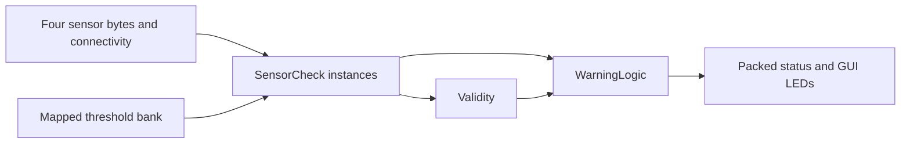

# Combinational monitoring core

`volcano.circ` contains the actual `SensorCheck`, `Validity`, `WarningLogic`, `MonitorCore` and `MonitorGUI` subcircuits. `MonitorGUI` instantiates the same core used by automation. Its input pins are the four unsigned eight-bit sensor values and four-bit connectivity mask. Labelled LEDs show effective per-sensor abnormalities, per-sensor faults, all four warning levels and emergency. Native Logisim exposes the circuit schematic and editable input pins. The automated check executes both core and GUI paths headlessly; no manual desktop GUI inspection is claimed in this environment.

`SensorCheck` compares value > threshold and value >100 using explicitly unsigned comparators. A sensor fault combines range error with missing connectivity. `Validity` requires mask=15 and range_mask=0. `WarningLogic` gates the raw flags by whole-record validity before a three-bit adder tree counts K. Warning bits are `(fault OR danger, fault OR watch)` from most to least significant. DANGER is valid AND K>1; emergency follows DANGER. A fault preserves raw/range diagnostics but forces effective flags and K to zero.

`MonitorCore.status` packs B2 exactly as specified in `spec/protocol.md`. Other outputs expose raw/range/sensor-fault masks, validity, effective flags, K, warning, emergency and each warning lamp. `core-map.json` records every physical interface pin and the shared threshold bank. Threshold constants are used by the actual sensor-check instances.

`python3 -B scripts/build_monitor.py` regenerates native components/wires from the checked-in builder. `--check` detects stale generated circuits/maps. The builder is a development tool; runtime inputs never regenerate XML. It uses explicit custom subcircuit ports and splitter maps. `make test-combinational` tests 43 independent frozen cases on both core and GUI (86 observed outputs), including all16 effective patterns, all six pairs, equality/below/above thresholds and faults. Actual stdout/stderr and expected/observed status words are in `reports/stage3/`.
